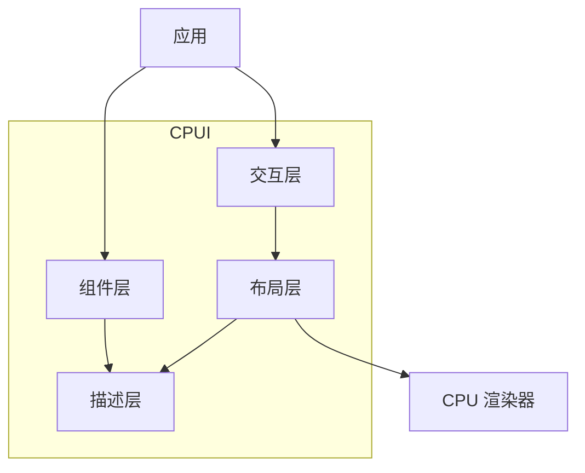

# CPUI 蓝图

本文档描述 CPUI 的目标形态、设计原则与演进方向，作为后续设计与实施的共同依据。具体实现细节在各阶段实施时另行确定，不在本文档范围内。

---

## 1. 定位

CPUI 是 Minc 的**基于 CPU 渲染的声明式桌面界面层**。

- 以声明式方式描述界面结构，以弹性盒模型完成布局，降低界面开发与维护的成本。
- 全部绘制由 CPU 完成，不依赖图形处理器、浏览器引擎或系统原生控件，在各类硬件与运行环境下表现一致。
- 以快速启动、低内存占用与稳定的交互响应为首要目标，服务于本地优先的写作应用。

CPUI 负责应用的界面外壳与通用交互组件，例如面板、对话框、弹出层、设置页、侧栏与列表。文档编辑区、代码视图等高度专门化的内容区域不由 CPUI 布局，而以自绘区域的形式嵌入其中。

---

## 2. 核心原则

### 2.1 CPU 渲染优先

渲染路径不依赖图形硬件。界面的流畅性来自减少不必要的绘制，而非依靠硬件算力重绘整个窗口。

### 2.2 只重绘变化的部分

未发生变化的界面内容在帧间复用，浮层、悬停、流式内容等局部变化只触发局部重绘。区分“底层内容变化”与“仅浮层变化”是渲染模型的基本约定。

### 2.3 声明式与无状态视图

视图是应用状态的纯函数：给定状态，构建出确定的界面描述。界面描述是一次性的，每帧重新构建；状态由应用以普通数据结构持有，不由界面层托管。

### 2.4 交互以动作表达

界面元素不直接持有回调或修改状态，而是声明其对应的动作标识。命中测试将用户操作解析为动作，由应用统一分发处理。界面描述因此保持纯粹，交互行为易于追踪与测试。

### 2.5 自绘区域作为一等能力

声明式布局与直接绘制并存。任何需要极致性能或特殊排版的内容，都可以作为自绘区域嵌入布局之中，在获得布局位置的同时自行完成绘制与命中。

### 2.6 保持轻量

CPUI 只提供界面开发所需的最小完备能力。不引入复杂的响应式运行时、全局状态管理、异步调度或插件体系；通用组件只在被多处实际需要时才沉淀。

---

## 3. 架构

CPUI 自下而上分为四个层次，每层只依赖其下层。

| 层次 | 职责 |
|---|---|
| **描述层** | 提供构建界面描述的基本元素（容器、文本、分隔、留白、自绘区域）及其样式表达（尺寸、间距、对齐、背景、边框、圆角、裁剪、滚动）。 |
| **布局层** | 对界面描述进行测量与弹性布局计算，结合文字测量与折行完成尺寸确定，并将结果绘制到渲染器。 |
| **交互层** | 收集布局后各交互区域及其动作，提供命中测试；管理帧间画面复用；提供弹出层定位与滚动区域等通用交互机制。 |
| **组件层** | 基于以上能力组合出的通用界面组件，如按钮、标签、勾选框、输入框槽位、对话框头尾栏与列表项。 |

主题与视觉规范以语义化的设计变量形式提供，由应用注入，CPUI 不内置具体配色。

---

## 4. 能力范围

### 4.1 布局与绘制

- 支持弹性盒模型的主要能力：方向、伸缩、换行对齐、间距、最小与最大尺寸。
- 支持文字的测量、自动折行与按内容收缩宽度。
- 支持背景、边框、圆角、阴影与卡片外观，支持区域裁剪与纵向滚动。
- 支持在任意位置嵌入自绘区域。

### 4.2 交互

- 基于布局结果的命中测试，后绘制的元素优先响应。
- 弹出层与浮层的锚定定位，并在空间不足时自动避让窗口边界。
- 滚动区域的偏移管理、滚动条呈现与滚轮事件处理。
- 与文本输入框及输入法的集成约定。

### 4.3 渲染效率

- 静态底层画面在浮层更新期间复用，不重复绘制。
- 局部变化仅重绘受影响的区域。
- 长列表只对可视范围内的内容进行布局与绘制。

### 4.4 可验证性

- 界面可在离屏环境中完整布局与绘制，无需真实窗口。
- 布局结果与命中区域可被程序化查询，支撑界面行为的自动化验证。

---

## 5. 与编辑器内核的关系

CPUI 与富文本编辑器内核是相互独立、平行的两个基础层：

- CPUI 负责界面外壳与通用组件，编辑器内核负责文档的解析、编辑与排版。
- 编辑区以自绘区域的形式嵌入 CPUI 布局，由编辑器内核自行完成绘制与命中。
- 编辑器装饰层中需要富交互的嵌入区块（如批注卡片、修订建议操作栏），可借助 CPUI 组件构建其内部界面。
- 两者共享同一 CPU 渲染器，但彼此不产生依赖。

---

## 6. 设计参考

| 关注领域 | 参考项目 |
|---|---|
| 声明式界面描述、弹性布局与自绘区域 | [GPUI](https://github.com/zed-industries/zed/tree/main/crates/gpui) |
| 即时模式界面与动作驱动的交互 | [egui](https://github.com/emilk/egui) |
| 状态与视图分离、消息驱动的架构 | [Iced](https://github.com/iced-rs/iced) |
| 弹性盒布局计算 | [Taffy](https://github.com/DioxusLabs/taffy) |
| 组件组织与视图树设计 | [Xilem](https://github.com/linebender/xilem) |

参考的目的在于借鉴已被验证的设计思想，而非移植其实现。CPUI 不追随上述项目的图形硬件渲染路径与运行时模型。

---

## 7. 演进方向

CPUI 按以下顺序分阶段演进，每一阶段均可独立交付，且不造成既有界面的倒退。

1. **独立成形**：将现有声明式界面能力从应用中剥离为独立模块，解除对应用主题、图标与文字处理的直接依赖，确立对外接口。
2. **交互机制完善**：补齐弹出层定位、滚动区域、输入框集成等通用交互机制，并将应用中仍以手工坐标实现的界面逐步迁移至 CPUI。
3. **渲染效率提升**：在帧间画面复用的基础上引入局部区域重绘与长列表可视范围渲染，进一步降低交互与空闲时的资源消耗。
4. **稳定与开放**：在应用内充分验证后，稳定公共接口，完善文档与示例，评估作为独立项目对外提供的可行性。

---

## 8. 约束与关注点

- **渲染路径**：不引入对图形硬件、浏览器引擎或系统原生控件的依赖。
- **复用正确性**：画面复用必须在底层内容变化时及时失效，避免残留陈旧画面；不再需要时立即释放。
- **职责边界**：专门化的内容区域通过自绘区域嵌入，不强行纳入声明式布局。
- **规模控制**：大量重复内容按可视范围渲染，不将全部数据纳入一次布局。
- **视觉精度**：文字基线、细线与边框在不同显示缩放下保持清晰与对齐。
- **复杂度控制**：保持最小完备，新增能力须有明确的多处实际需求。
- **可验证性**：布局与交互行为均有对应的离屏自动化验证。
