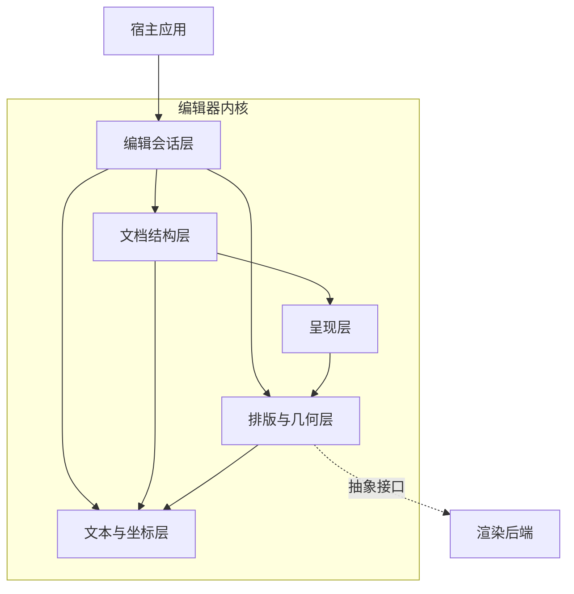

# 富文本编辑器蓝图

本文档描述 Minc 富文本编辑器的目标形态、设计原则与演进方向，作为后续设计与实施的共同依据。具体实现细节在各阶段实施时另行确定，不在本文档范围内。

---

## 1. 定位

Minc 的富文本编辑器是一个**以 Markdown 文本为唯一数据源的所见即所得编辑器**。

- 文档以标准 Markdown 文本形式存储与编辑，格式开放、可移植、可被任意工具读取与版本管理。
- 编辑界面以排版后的富文本形式呈现，用户在阅读与书写时无需面对标记语法；仅在需要时，于局部按需显示对应的源码标记。
- 编辑器面向长篇写作与知识整理。

---

## 2. 核心原则

### 2.1 单一数据源

Markdown 文本是文档的唯一事实来源。富文本视图、文档结构、排版结果均为文本的派生投影，可随时由文本重新生成。任何编辑操作最终都表现为对文本的变更，不存在独立于文本、需要与之同步的第二份可变文档模型。

### 2.2 编辑优先于解析

编辑操作的正确性与响应性不依赖于全文解析的完成状态。结构化编辑基于当前文本的局部上下文即时完成；全文结构分析可以滞后或异步进行，但不得影响用户输入的即时反馈。

### 2.3 内核独立

编辑器内核与宿主应用、窗口系统、界面框架及渲染后端相互独立。内核只通过明确定义的抽象接口获取文字测量能力、输出绘制结果，从而可以在无界面环境中完整运行与验证。

### 2.4 内容与呈现分离

文档内容与附加呈现严格区分。搜索高亮、链接校验提示、批注、修订建议等不属于文档内容的信息，统一作为独立的装饰层叠加在视图之上，不写入文档文本。

### 2.5 变更可追溯、可撤销

所有对文档的修改——无论来自键盘输入、结构命令还是粘贴——都以原子事务的形式提交，纳入统一的撤销历史，符合用户对撤销粒度的直觉预期。

### 2.6 性能与体验不随规模劣化

编辑器在长文档下仍保持即时响应与稳定的资源占用。解析、排版与绘制均以增量方式进行，只处理受影响的部分，并按可视范围管理资源。

---

## 3. 架构

编辑器内核自下而上分为五个层次，每层只依赖其下层，职责单一。

| 层次 | 职责 |
|---|---|
| **文本与坐标层** | 持有文档文本、编辑事务与撤销历史；统一管理文本中的各类位置表示及其相互换算；在文本变更后为一切派生位置提供准确的映射。 |
| **文档结构层** | 将文本解析为文档结构，并维护结构与文本位置之间的对应关系；在文本变更时以增量方式更新结构。 |
| **呈现层** | 根据文档结构与当前光标状态，决定每一处内容以富文本还是源码标记形式呈现；合成装饰层，形成最终的可视内容描述。 |
| **排版与几何层** | 将可视内容排版为可绘制的结果；提供视图坐标与文本位置之间的双向映射，支撑点击定位、选区绘制、光标移动与输入法定位。 |
| **编辑会话层** | 接收用户输入与命令，结合文档结构与排版几何，解释其编辑语义，产出文本变更与新的光标状态。 |

宿主应用负责事件采集、资源加载、界面集成与最终绘制，不承担编辑语义。

---

## 4. 能力范围

### 4.1 内容表达

覆盖 CommonMark 与常用扩展：标题、段落、强调、链接、图片、列表与任务列表、引用与提示块、代码块、表格、数学公式、图表、脚注、文档属性等。对超出 Markdown 表达能力的需求，优先通过约定的扩展语法表达，而非引入私有存储格式。

### 4.2 编辑语义

- 以接近排版结果的方式编辑内容，结构化操作（换行、缩进、列表与引用的延续与退出、表格单元格导航与结构调整等）符合用户对富文本编辑器的直觉。
- 输入规则在书写过程中自动识别常见 Markdown 写法并即时转换为对应结构，且转换本身可单独撤销。
- 行内格式的添加与移除遵循一致的边界规则。
- 复制与粘贴在 Markdown、纯文本与富文本格式之间正确转换，外部内容经规范化后写入。
- 完整支持各类输入法的组字过程。

### 4.3 呈现与交互

- 源码标记仅在光标所及的局部显示，显示与隐藏的切换不引起视觉跳动或定位偏差。
- 选区、复制、删除等操作正确处理不可见的标记，保证文档结构完整。
- 视图中可在任意位置嵌入不属于文档内容的交互区块，用于承载批注、修订建议等。

---

## 5. 设计参考

| 关注领域 | 参考项目 |
|---|---|
| 状态模型、事务、位置映射与装饰层 | [CodeMirror 6](https://github.com/codemirror/view)（[state](https://github.com/codemirror/state)） |
| 增量 Markdown 解析 | [Lezer Markdown](https://github.com/lezer-parser/markdown) |
| 以 Markdown 为数据源的实时预览写作体验 | [Zettlr](https://github.com/Zettlr/Zettlr)、[MarkText](https://github.com/marktext/marktext) |
| 输入规则与编辑命令组织 | [ProseMirror](https://github.com/ProseMirror/prosemirror-state)、[Milkdown](https://github.com/Milkdown/milkdown) |
| 脱离浏览器的文档模型、布局与命令分层 | [SuperEditor](https://github.com/Flutter-Bounty-Hunters/super_editor) |
| 富文本排版、字形成形与光标几何 | [Parley](https://github.com/linebender/parley)、[cosmic-text](https://github.com/pop-os/cosmic-text) |
| 文本之上的显示映射与虚拟区块 | [Zed Editor](https://github.com/zed-industries/zed/tree/main/crates/editor) |
| 增量排版与数学排版 | [Typst](https://github.com/typst/typst) |

参考的目的在于借鉴已被验证的设计思想，而非移植其实现或依赖其运行环境。

---

## 6. 演进方向

编辑器按以下顺序分阶段演进，每一阶段均可独立交付，且不造成既有体验的倒退。

1. **内核成形**：将现有的解析、排版、编辑与光标逻辑整合为独立内核，确立层次边界与对外接口，并建立无界面环境下的验证体系。
2. **编辑体验完善**：统一坐标表示，系统化输入规则与编辑命令，全面完善各类结构的编辑语义与边界行为。
3. **增量化与装饰层**：实现文档结构的增量更新与精确位置映射；建立统一的装饰层与嵌入区块机制。
4. **排版能力提升**：持续提升文字排版质量与复杂内容的呈现能力，并针对长文档进一步优化。

---

## 7. 约束与关注点

- **数据源一致性**：任何新能力均不得引入与文本并存的可变文档模型。
- **位置正确性**：多语言文字、组合字符与不同换行风格下，位置换算与光标行为必须保持正确。
- **标记显隐稳定性**：源码标记的显示切换不得影响点击定位、光标移动与选区的准确性。
- **输入法完整性**：组字过程中的内容不进入文档与撤销历史，不触发自动转换。
- **结构完整性**：选区操作、跨结构编辑与外部内容粘贴不得产生残缺或非法的文档结构。
- **规模稳定性**：资源占用与响应时间在长文档下保持可控。
- **可验证性**：编辑语义的每一项行为均有对应的自动化验证，缺陷修复须附带回归用例。
