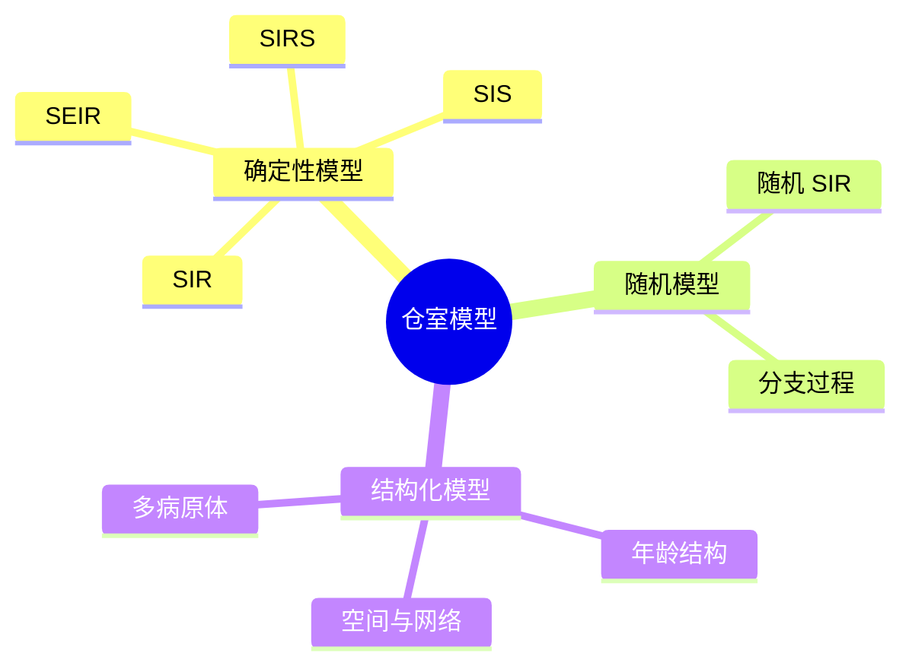
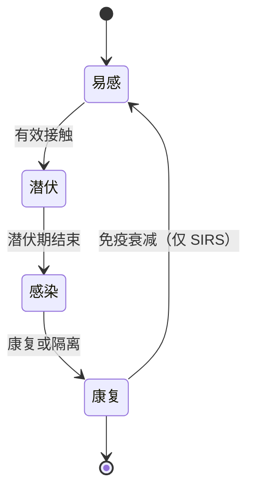
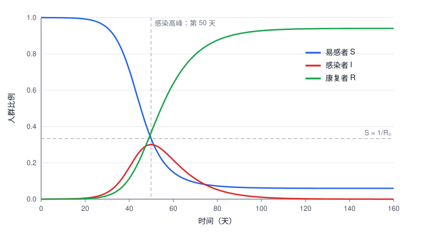
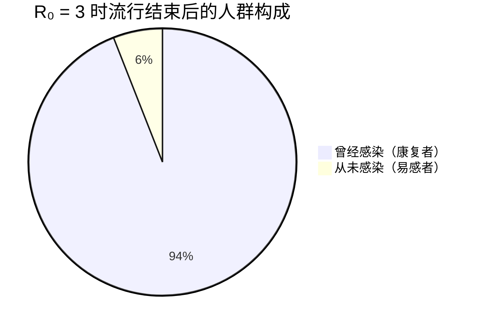
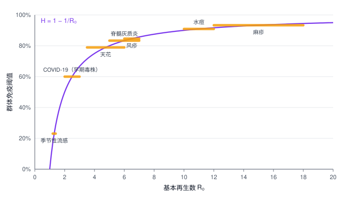
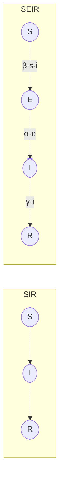
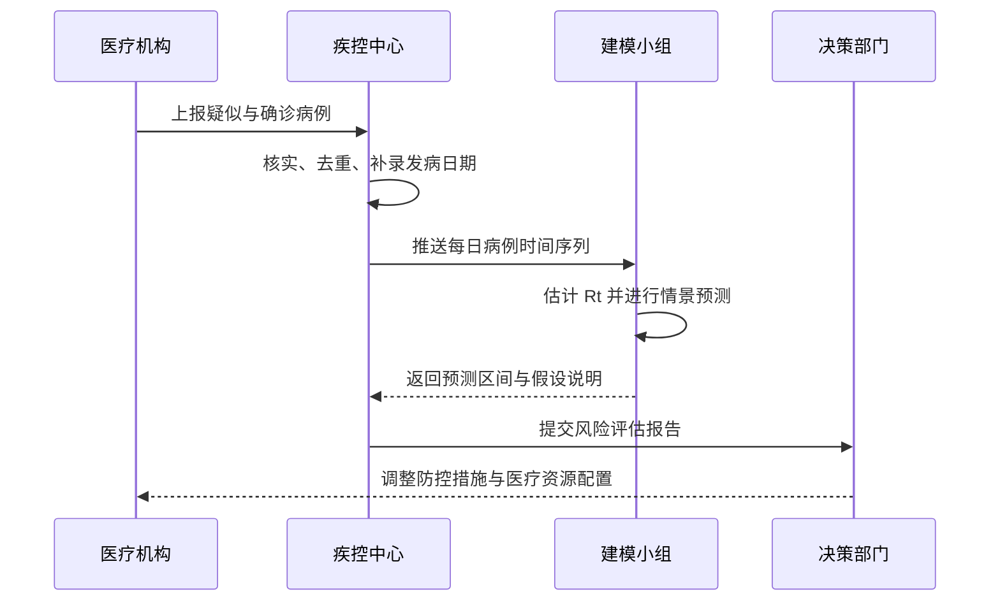
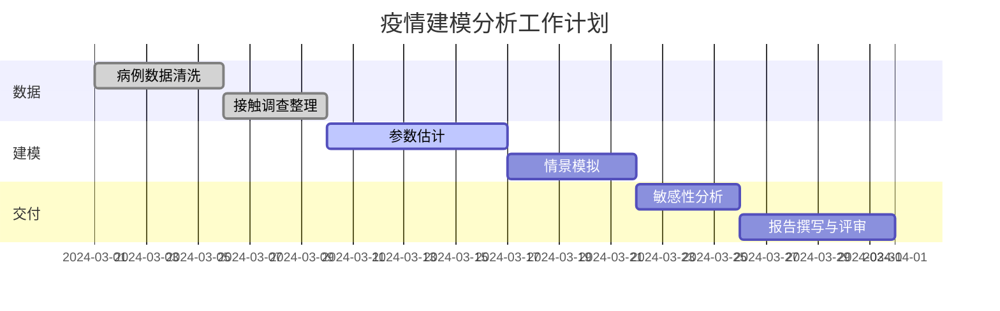
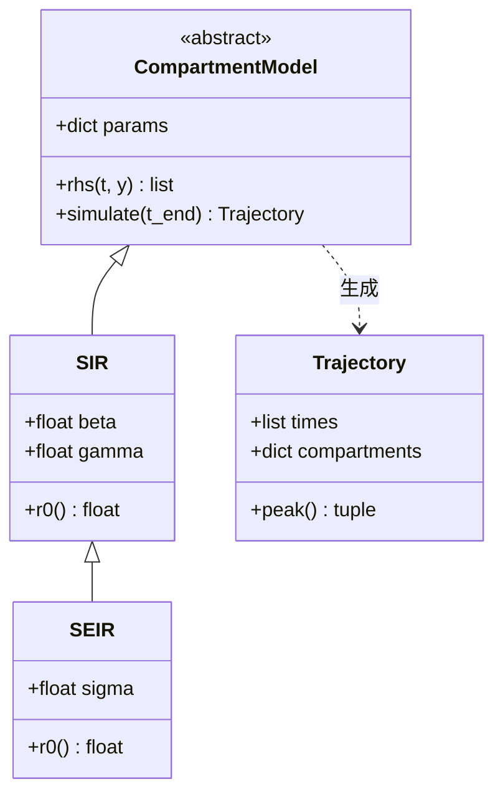
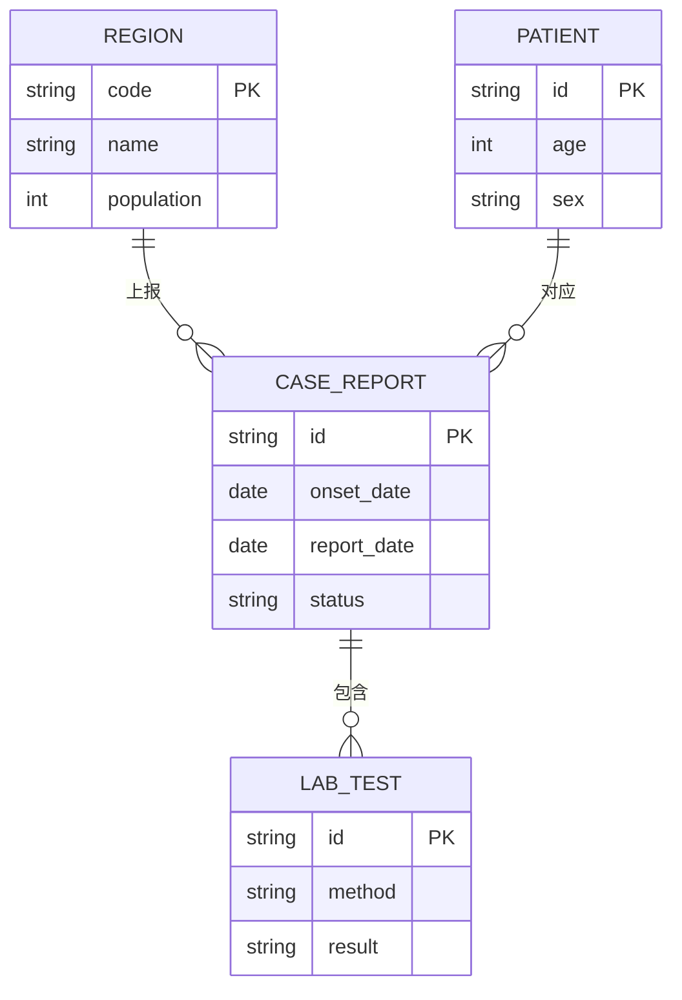

# 传染病动力学入门：SIR 模型、基本再生数与群体免疫

公共卫生建模学习小组  
2024 年 3 月 · 第 1.2 版\
适用读者：具备微积分基础的公共卫生、统计与计算机专业读者

**摘要** 🦠 本文从仓室模型的基本思想出发，系统介绍经典 *SIR* 模型的建立、求解与解读，重点讨论**基本再生数** $R_0$ 的含义、流行的阈值现象、感染高峰与最终规模的解析结果，以及群体免疫阈值 $H = 1 - 1/R_0$ 与疫苗接种策略之间的关系。文末给出可复现的数值实现与一个完整的分析工程示例。

[TOC]

---

## 1 引言

用数学描述传染病的传播有着悠久的历史。早在 1760 年，Daniel Bernoulli 就用数学方法评估了天花人痘接种对预期寿命的影响[^bernoulli]；1911 年，Ronald Ross 在研究疟疾时提出了蚊媒传播的数学模型。真正奠定现代传染病动力学基础的，是 Kermack 与 McKendrick 在 1927 年发表的论文[^km]，其中提出的模型如今被称为 **SIR 模型**。

模型的价值不在于精确复现现实，而在于用尽可能少的假设揭示传播的关键机制。统计学家 George Box 的一句话常被用来提醒建模者保持谦逊：

> All models are wrong, but some are useful.
>
> — George E. P. Box，1979

> [!NOTE]
> 本文讨论的均为**确定性**、**均匀混合**的群体模型。随机效应、人群异质性与空间结构对结论的影响，将在 [第 9 节](#9-模型的局限性) 中简要讨论。

<!-- 维护者备注：随机模型（分支过程）章节待补充，计划在 v1.3 中加入。 -->

## 2 仓室模型的基本思想

仓室模型（compartmental model）把总人口按照疾病状态划分为若干互不重叠的“仓室”，并用微分方程描述个体在仓室之间的流动。最常见的仓室包括：

- **S**（Susceptible）：易感者，尚未感染、可能被感染的人；
- **E**（Exposed）：潜伏者，已感染但尚不具传染性；
- **I**（Infectious）：感染者，具有传染性；
- **R**（Removed / Recovered）：移出者，因康复获得免疫、被隔离或死亡而不再参与传播。

不同仓室的组合构成了一个模型家族：



从单个个体的角度看，疾病进程就是在若干状态之间的转移：



经典 SIR 模型建立在以下假设之上：

1. 人群规模 $N$ 恒定，忽略出生、自然死亡与迁移；
2. 人群**均匀混合**，任意两人之间的接触概率相同；
3. 感染者在单位时间内与他人发生有效接触的次数为常数 $\beta$；
4. 感染者以恒定速率 $\gamma$ 移出，即感染期服从均值为 $1/\gamma$ 的指数分布；
5. 康复者获得永久免疫。

假设 2 与假设 4 是 SIR 模型最常被批评的两点，也是后续扩展模型的主要出发点。

## 3 SIR 模型

### 3.1 模型方程

记 $S(t)$、$I(t)$、$R(t)$ 分别为 $t$ 时刻三个仓室的人数。根据上述假设，有

$$
\begin{aligned}
\frac{dS}{dt} &= -\beta \frac{S I}{N}, \\
\frac{dI}{dt} &= \beta \frac{S I}{N} - \gamma I, \\
\frac{dR}{dt} &= \gamma I.
\end{aligned}
$$

三个方程相加得 $\frac{d}{dt}(S + I + R) = 0$，即总人口守恒：$S + I + R = N$。为方便起见，下文用小写字母 $s = S/N$、$i = I/N$、$r = R/N$ 表示各仓室占总人口的==比例==。

仓室之间的流动关系可以用流程图表示：


### 3.2 参数及其含义

表 1 汇总了模型参数的含义与单位[^units]。

| 符号 | 含义 | 单位 | 典型取值（本文示例） |
|:---:|:---|:---:|---:|
| $N$ | 总人口 | 人 | $10^6$ |
| $\beta$ | 传播率：单个感染者单位时间内的有效接触数 | 天<sup>-1</sup> | 0.30 |
| $\gamma$ | 移出率 | 天<sup>-1</sup> | 0.10 |
| $1/\gamma$ | 平均感染期 | 天 | 10 |
| $i_0$ | 初始感染比例 | — | 10<sup>-4</sup> |

### 3.3 首次积分

用第一个方程除第二个方程，消去时间 $t$：

$$
\frac{di}{ds} = -1 + \frac{\gamma}{\beta s} = -1 + \frac{1}{R_0\, s},
$$

积分后得到沿轨道守恒的量

$$
i + s - \frac{1}{R_0} \ln s = \text{const}.
$$

这一首次积分是后文求峰值与最终规模的关键。

## 4 基本再生数与阈值现象

**基本再生数** $R_0$ 定义为：在完全易感的人群中，一个典型感染者在整个感染期内平均直接传染的新病例数。对 SIR 模型，

$$
R_0 = \frac{\beta}{\gamma}.
$$

在流行初期 $s \approx 1$，感染者数量的变化由 $\frac{di}{dt} \approx (\beta - \gamma)\, i = \gamma (R_0 - 1)\, i$ 决定，于是得到著名的**阈值定理**：

$$
\text{流行初期}\quad
\begin{cases}
R_0 > 1, & \text{感染者数量先增长，发生流行；} \\
R_0 \le 1, & \text{感染者数量单调下降，不会发生大规模流行。}
\end{cases}
$$

流行开始后，更有实际意义的是**有效再生数** R<sub>t</sub> $= R_0\, s(t)$。只要 $R_t > 1$，疫情就仍在扩张；防控措施的目标正是把 R<sub>t</sub> 压到 1 以下。

> [!TIP]
> 初期指数增长率 $r = \gamma(R_0 - 1)$ 与倍增时间 $T_d = \ln 2 / r$ 都可以直接从病例时间序列中估计，因此常被用来反推 $R_0$。以本文参数为例，$r = 0.2$ 天<sup>-1</sup>，$T_d \approx 3.5$ 天。

### 4.1 一个数值例子

取 $\beta = 0.3$、$\gamma = 0.1$（即 $R_0 = 3$），$i_0 = 10^{-4}$，对方程组数值积分 160 天，结果如图 1 所示。



*图 1：易感者、感染者与康复者比例随时间的变化。虚线标出了感染高峰时刻及 $s = 1/R_0$ 的位置。*

从数值解中可以读出几个关键结果：

- 感染高峰出现在约**第 50 天**，此时约 **30.1%** 的人口处于感染状态；
- 高峰时刻恰好满足 $s = 1/R_0 \approx 0.333$；
- 流行结束时，约 **94.0%** 的人口曾被感染，仍有约 6.0% 的人从未被感染。

流行结束后的人群构成如下：



### 4.2 峰值与最终规模

#### 4.2.1 感染高峰

由 $\frac{di}{dt} = i(\beta s - \gamma)$ 可知，$i$ 在 $s = 1/R_0$ 时取得最大值。

<details>
<summary>展开：峰值感染比例的推导</summary>

利用 3.3 节的首次积分，并取初始条件 $s_0 \approx 1$、$i_0 \approx 0$：

$$
i + s - \frac{1}{R_0}\ln s = 1.
$$

代入 $s = 1/R_0$，得

$$
i_{\max} = 1 - \frac{1 + \ln R_0}{R_0}.
$$

当 $R_0 = 3$ 时，$i_{\max} = 1 - (1 + \ln 3)/3 \approx 0.3005$，与图 1 的数值结果一致。

</details>

#### 4.2.2 最终规模方程

令 $t \to \infty$，此时 $i_\infty = 0$。记最终累计感染比例 $z = 1 - s_\infty$，由首次积分得到**最终规模方程**：

$$
z = 1 - e^{-R_0 z}.
$$

##### 推论

当 $R_0 > 1$ 时，该方程在 $(0, 1)$ 内有唯一正根。即使不采取任何干预，也总有一部分人不会被感染——流行的终止是因为易感者变得稀少，而不是因为所有人都已感染。

###### 备注

最终规模方程对感染期的分布并不敏感：只要 $R_0$ 相同，许多更复杂的模型会给出相同的最终规模。这一性质使它在实际评估中格外有用。

## 5 群体免疫与疫苗接种

若人群中比例为 $p$ 的人在流行前已获得免疫，则有效再生数降为 $R_0(1 - p)$。令其不超过 1，得到**群体免疫阈值**：

$$
H = 1 - \frac{1}{R_0}.
$$

表 2 列出了几种常见传染病 $R_0$ 的代表性估计区间及对应的群体免疫阈值[^r0]。

| 疾病 | 主要传播途径 | $R_0$ 估计区间 | 群体免疫阈值 $H$ | 参考文献 |
|:---|:---:|:---:|---:|:---:|
| 季节性流感 | 飞沫 | 1.2 – 1.4 | 17% – 29% | [7] |
| COVID-19（早期毒株） | 飞沫、气溶胶 | 2 – 3 | 50% – 67% | [11] |
| 天花 | 飞沫、接触 | 3.5 – 6 | 71% – 83% | [6] |
| 脊髓灰质炎 | 粪-口 | 5 – 7 | 80% – 86% | [2] |
| 风疹 | 飞沫 | 6 – 7 | 83% – 86% | [2] |
| 水痘 | 空气 | 10 – 12 | 90% – 92% | [2] |
| **麻疹** | **空气** | **12 – 18** | **92% – 94%** | [8] |



*图 2：群体免疫阈值随 $R_0$ 的变化。橙色线段为表 2 中各疾病的 $R_0$ 估计区间。*

可以看出，$H$ 随 $R_0$ 增大而迅速逼近 100%。这解释了为什么麻疹需要极高的疫苗覆盖率才能阻断传播，而流感即使在较低覆盖率下也能显著降低流行规模。

> [!WARNING]
> 群体免疫阈值基于均匀混合假设。现实中接触网络高度异质，免疫在人群中的分布也不均匀，局部低覆盖率的社区仍可能暴发疫情。因此，<u>达到全国平均阈值并不意味着每个社区都已安全</u>。

更一般地，在疫苗覆盖率 $p$ 下，最终累计感染比例（占总人口）为 $(1-p)\,z$，其中 $z$ 满足 $z = 1 - e^{-R_0 (1-p) z}$。图 3 给出了不同 $R_0$ 与覆盖率组合下的结果。

[](images/attack-rate-heatmap.png)

*图 3：横轴为 $R_0$（1 – 8），纵轴为疫苗覆盖率（0 – 95%，自下而上递增），颜色越亮表示最终感染比例越高。白色曲线为群体免疫阈值 $p = 1 - 1/R_0$，曲线上方不会发生大规模流行。点击图片可查看原图。*

表 3 给出了部分组合的精确数值（单位：占总人口的百分比）。

| 疫苗覆盖率 \ $R_0$ | 1.5 | 2 | 2.5 | 3 | 4 | 6 | 10 | 15 |
|:---|---:|---:|---:|---:|---:|---:|---:|---:|
| 0% | 58.3 | 79.7 | 89.3 | 94.0 | 98.0 | 99.7 | 100.0 | 100.0 |
| 20% | 25.1 | 51.4 | 63.7 | 70.3 | 76.2 | 79.3 | 80.0 | 80.0 |
| 40% | 0.0 | 18.8 | 35.0 | 43.9 | 52.7 | 58.2 | 59.8 | 60.0 |
| 60% | 0.0 | 0.0 | 0.0 | 12.5 | 25.7 | 35.1 | 39.2 | 39.9 |
| 80% | 0.0 | 0.0 | 0.0 | 0.0 | 0.0 | 6.3 | 15.9 | 18.8 |

## 6 模型的扩展

### 6.1 SEIR 模型

许多传染病存在不具传染性的潜伏期。引入潜伏者仓室 $E$ 及潜伏期结束速率 $\sigma$（平均潜伏期为 $1/\sigma$），得到 SEIR 模型：

$$
\begin{aligned}
\frac{ds}{dt} &= -\beta s i, &
\frac{de}{dt} &= \beta s i - \sigma e, \\
\frac{di}{dt} &= \sigma e - \gamma i, &
\frac{dr}{dt} &= \gamma i.
\end{aligned}
$$



潜伏期不改变 $R_0$ 与最终规模，但会拉长流行周期、推迟并压低感染高峰。完整推导可参阅笔记 [[SEIR 模型推导]]。

### 6.2 用下一代矩阵计算 $R_0$

对于包含多个感染仓室的模型，$R_0$ 可以通过**下一代矩阵**方法计算[^ngm]。将感染仓室 $(e, i)$ 的变化拆分为新感染项 $\mathcal{F}$ 与转移项 $\mathcal{V}$，在无病平衡点处求雅可比矩阵：

$$
F = \begin{pmatrix} 0 & \beta \\ 0 & 0 \end{pmatrix}, \qquad
V = \begin{pmatrix} \sigma & 0 \\ -\sigma & \gamma \end{pmatrix}.
$$

于是

$$
F V^{-1} = \begin{bmatrix} \dfrac{\beta}{\gamma} & \dfrac{\beta}{\gamma} \\ 0 & 0 \end{bmatrix},
\qquad
R_0 = \rho\left(F V^{-1}\right) = \frac{\beta}{\gamma},
$$

其中 $\rho(\cdot)$ 表示谱半径。对于感染力随感染年龄 $\tau$ 变化的一般情形，$R_0$ 可写成积分形式

$$
R_0 = \int_0^{\infty} \beta(\tau)\, \mathcal{P}(\tau)\, d\tau,
$$

其中 $\mathcal{P}(\tau)$ 为感染后经过 $\tau$ 时间仍具传染性的概率。

## 7 数值实现

### 7.1 Python

以下代码使用 `scipy.integrate.solve_ivp` 求解 SIR 模型，可在 Jupyter 中按 <kbd>Shift</kbd> + <kbd>Enter</kbd> 运行：

```python
import numpy as np
from scipy.integrate import solve_ivp


def sir(t, y, beta, gamma):
    s, i, r = y
    new_infections = beta * s * i
    return [-new_infections, new_infections - gamma * i, gamma * i]


beta, gamma, i0 = 0.3, 0.1, 1e-4
sol = solve_ivp(
    sir,
    (0, 160),
    [1 - i0, i0, 0.0],
    args=(beta, gamma),
    dense_output=True,
    rtol=1e-8,
    atol=1e-10,
)

t = np.linspace(0, 160, 1601)
s, i, r = sol.sol(t)
print(f"R0 = {beta / gamma:.2f}")
print(f"峰值时间 ≈ 第 {t[np.argmax(i)]:.1f} 天，峰值感染比例 ≈ {i.max():.4f}")
print(f"最终累计感染比例 ≈ {r[-1]:.4f}")
```

运行输出：

~~~text
R0 = 3.00
峰值时间 ≈ 第 49.9 天，峰值感染比例 ≈ 0.3005
最终累计感染比例 ≈ 0.9404
~~~

### 7.2 R

使用 `deSolve` 包的等价实现：

```r
library(deSolve)

sir <- function(t, y, p) {
  with(as.list(c(y, p)), {
    dS <- -beta * S * I
    dI <-  beta * S * I - gamma * I
    dR <-  gamma * I
    list(c(dS, dI, dR))
  })
}

out <- ode(
  y = c(S = 1 - 1e-4, I = 1e-4, R = 0),
  times = seq(0, 160, by = 0.1),
  func = sir,
  parms = c(beta = 0.3, gamma = 0.1)
)
```

### 7.3 情景配置与复现

为便于复现，建议把情景参数写入配置文件，而不是硬编码在脚本里：

```json
{
  "scenario": "baseline",
  "model": "SIR",
  "parameters": { "beta": 0.3, "gamma": 0.1 },
  "initial": { "s": 0.9999, "i": 0.0001, "r": 0.0 },
  "horizon_days": 160,
  "solver": { "method": "RK45", "rtol": 1e-8, "atol": 1e-10 }
}
```

本文所有插图均可通过同目录下的 [`generate_figures.py`](generate_figures.py) 重新生成，该脚本只依赖 Python 标准库：

```bash
cd testdata/markdown/epidemic-modeling
python3 generate_figures.py
```

> [!IMPORTANT]
> 使用固定步长的显式方法（如欧拉法）时，步长过大会导致 $s + i + r$ 偏离 1，甚至出现负的仓室比例。建议使用自适应步长的求解器，并在结果中检查守恒量与非负性。

## 8 从模型到决策

模型结果要真正服务于公共卫生决策，需要嵌入一条完整的数据与沟通链路：



一次典型的建模分析通常按如下计划推进：



发布模型结果前，建议逐项核对以下清单：

- [x] 明确列出全部模型假设及其依据
- [x] 参数来源可追溯，单位一致
- [x] 报告不确定性区间，而非单一点估计
  - [x] 参数不确定性
  - [ ] 结构不确定性（不同模型之间的比较）
- [ ] 完成关键参数的敏感性分析
- [ ] 由未参与建模的同行独立复核代码

> [!CAUTION]
> 不要把情景模拟的结果当作“预测”发布。情景回答的是“如果……会怎样”，其结论依赖于对未来行为与政策的假设；脱离假设单独引用数字，极易造成误解。

## 9 模型的局限性

SIR 模型的简洁性既是优点也是局限。主要问题包括：

- **人群异质性**
  - 年龄结构：儿童与老人的接触模式差异显著；
  - 空间结构：城乡之间、地区之间的传播存在明显延迟；
  - 接触网络：少数“超级传播者”可能主导传播过程。
    - 这时，平均意义上的 $R_0$ 会掩盖个体传播能力的高度离散。
- **感染期分布**：指数分布假设意味着感染期没有“记忆”，与多数疾病的实际病程不符。
- **行为反馈**：人们会随疫情发展改变行为，使 $\beta$ 本身随时间变化。
- ~~人口规模恒定的假设在任何时间尺度上都可以忽略~~（对于持续数年的地方性流行，必须考虑出生与死亡）。

> 关于模型与现实的关系，可以概括为两句话：
>
> > 模型是思考的工具，而不是现实的替代品。
>
> 好的模型应当**清楚地告诉使用者它在什么条件下会失效**。

尽管如此，SIR 模型给出的阈值现象、最终规模与群体免疫阈值等定性结论，在更复杂的模型中依然成立，这正是它历经近百年仍被广泛使用的原因 :bulb:。

---

## 附录 A 符号表

| 符号 | 含义 | 备注 |
|:---|:---|:---|
| $s, i, r$ | 易感者、感染者、移出者占总人口的比例 | $s + i + r = 1$ |
| $\beta$ | 传播率 | 也可写作接触率 × 每次接触的传播概率 P(感染 \| 接触) |
| $\gamma$ | 移出率 | $1/\gamma$ 为平均感染期 |
| $\sigma$ | 潜伏期结束速率 | 仅用于 SEIR 模型 |
| $R_0$ | 基本再生数 | 完全易感人群中的平均传染数 |
| R<sub>t</sub> | 有效再生数 | $R_t = R_0\, s(t)$ |
| $H$ | 群体免疫阈值 | $H = 1 - 1/R_0$ |
| $z$ | 最终累计感染比例 | 满足 $z = 1 - e^{-R_0 z}$ |

本文中星号 \* 仅作普通字符使用，不表示强调；版权符号写作 &copy;，不间断空格写作 `&nbsp;`。

## 附录 B 分析工程示例

本附录展示一个小型建模工程的代码结构、数据结构与版本演进，供组织类似工作时参考。

模型代码的类结构：



监测数据的实体关系：



分析代码的版本演进：


工程目录约定如下（缩进式代码块）：

    epidemic-modeling/
    ├── config/          情景参数
    ├── data/            脱敏后的监测数据
    ├── models/          模型实现
    ├── notebooks/       探索性分析
    └── reports/         对外发布的报告

## 参考文献

1. Kermack W O, McKendrick A G. A contribution to the mathematical theory of epidemics. *Proceedings of the Royal Society of London. Series A*, 1927, 115(772): 700–721. [doi:10.1098/rspa.1927.0118][km1927]
2. Anderson R M, May R M. *Infectious Diseases of Humans: Dynamics and Control*. Oxford: Oxford University Press, 1991.
3. Hethcote H W. The mathematics of infectious diseases. *SIAM Review*, 2000, 42(4): 599–653. [doi:10.1137/S0036144500371907][hethcote2000]
4. Diekmann O, Heesterbeek J A P, Metz J A J. On the definition and the computation of the basic reproduction ratio R<sub>0</sub> in models for infectious diseases in heterogeneous populations. *Journal of Mathematical Biology*, 1990, 28(4): 365–382.
5. van den Driessche P, Watmough J. Reproduction numbers and sub-threshold endemic equilibria for compartmental models of disease transmission. *Mathematical Biosciences*, 2002, 180(1–2): 29–48.
6. Gani R, Leach S. Transmission potential of smallpox in contemporary populations. *Nature*, 2001, 414: 748–751.
7. Biggerstaff M, Cauchemez S, Reed C, et al. Estimates of the reproduction number for seasonal, pandemic, and zoonotic influenza: a systematic review of the literature. *BMC Infectious Diseases*, 2014, 14: 480.
8. Guerra F M, Bolotin S, Lim G, et al. The basic reproduction number (R<sub>0</sub>) of measles: a systematic review. *The Lancet Infectious Diseases*, 2017, 17(12): e420–e428.
9. Fine P, Eames K, Heymann D L. "Herd immunity": a rough guide. *Clinical Infectious Diseases*, 2011, 52(7): 911–916.
10. Box G E P. Robustness in the strategy of scientific model building. In: Launer R L, Wilkinson G N (eds.). *Robustness in Statistics*. New York: Academic Press, 1979: 201–236.
11. Liu Y, Gayle A A, Wilder-Smith A, Rocklöv J. The reproductive number of COVID-19 is higher compared to SARS coronavirus. *Journal of Travel Medicine*, 2020, 27(2): taaa021.

延伸阅读：<https://en.wikipedia.org/wiki/Compartmental_models_in_epidemiology>，以及世界卫生组织网站 www.who.int 上的相关技术文件。

<small>本文为学习材料，数值示例仅用于说明模型性质，不构成任何疫情预测或防控建议。</small>

[km1927]: https://doi.org/10.1098/rspa.1927.0118 "Kermack & McKendrick (1927)"
[hethcote2000]: https://doi.org/10.1137/S0036144500371907

[^bernoulli]: Bernoulli 于 1760 年向巴黎科学院宣读了这项研究，论文于 1766 年正式发表。他比较了“接种人痘”与“不接种”两种情形下的预期寿命，是最早的传染病数学分析之一。

[^km]: 原论文中的模型比今天的 SIR 模型更一般，允许传播率与移出率随感染年龄变化。常见的常系数 SIR 模型只是其中的一个特例。

[^units]: 本文时间单位均为“天”。若改用“周”，$\beta$ 与 $\gamma$ 需同时乘以 7，而 $R_0 = \beta/\gamma$ 保持不变。

[^r0]: $R_0$ 并不是病原体的固有常数，它同时取决于病原体特性、人群接触模式与社会环境。同一疾病在不同时间、地点与研究方法下的估计可能相差数倍。

    例如，Guerra 等人的系统综述发现，麻疹 $R_0$ 的已发表估计值跨度远大于教科书中常引用的 12 – 18。表 2 中的区间仅用于说明量级。

[^ngm]: 该方法由 Diekmann、Heesterbeek 与 Metz 于 1990 年提出[^ngm-ref]，van den Driessche 与 Watmough 在 2002 年给出了便于计算的具体形式。

[^ngm-ref]: 见参考文献 [4] 与 [5]。
